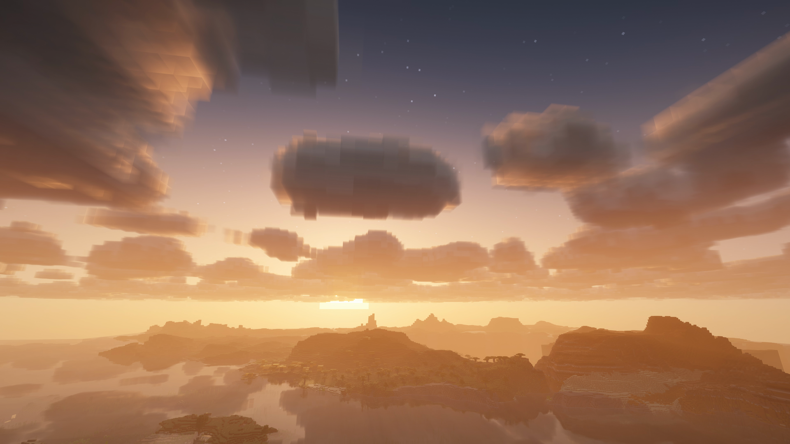
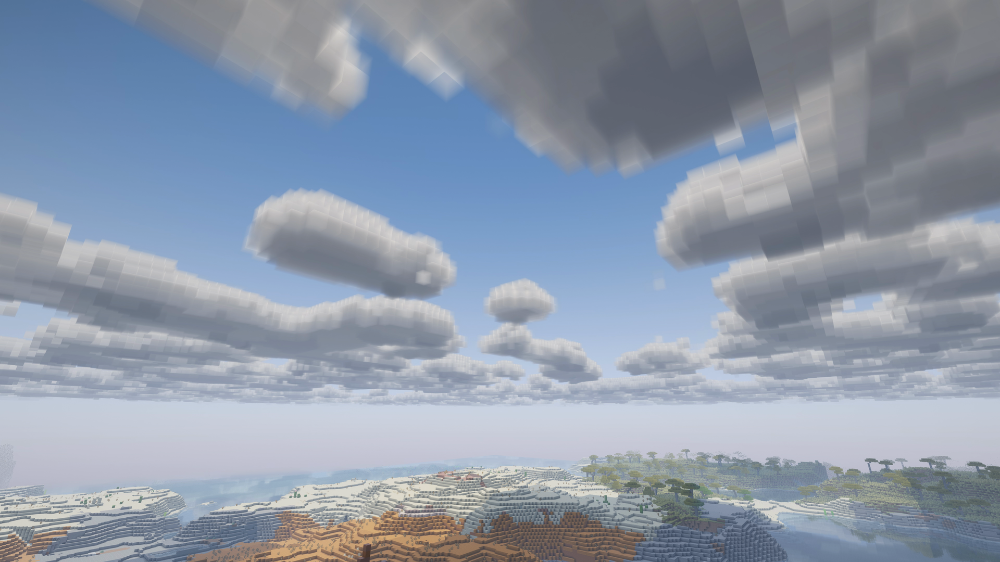
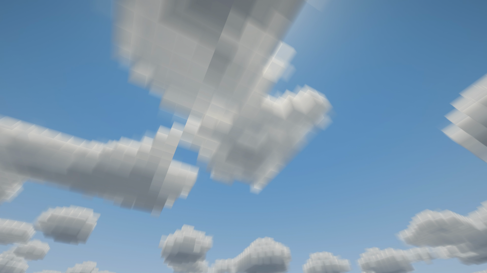

# Cloudscape Volumetric

Volumetric, voxel-shaped clouds with adjustable wind and gradual cloud-cover changes for **Minecraft Java 26.3 / Fabric / Iris / Complementary Reimagined**.

**Experimental release candidate: 0.5.7-rc.1.** Frame-time acceptance is incomplete; this repository is a public source snapshot, not an announcement of a stable release. The current cloud shapes, edge clarity and rendering quality are frozen from the accepted `0.5.7-sharp.1` baseline.

[Русская инструкция](README.md) · [Acceptance results](docs/ACCEPTANCE.md) · [Development](docs/DEVELOPMENT.md)



## Features

- Volumetric cubic clouds with varied formations and visible depth from below, above and inside the layer.
- Gradual transitions between clear, partly cloudy and overcast periods, influenced by Minecraft rain and thunder.
- Independently adjustable wind and shape evolution. Wind 0 stops cloud drift.
- Cloud lighting, shadows and reflections integrated with the supported Complementary pipeline.
- In-game configuration with apply/cancel, preserved existing settings and weather-phase persistence on a normal world exit.
- English and Russian menus, settings and diagnostics, following the selected Minecraft language.

Cloudscape is client-side. It adds visual clouds, not cloud blocks or a sky dimension. Cloud weather is calculated locally; synchronization between players is not guaranteed.

## Tested setup

| Component | Version |
| --- | --- |
| Minecraft Java Edition | 26.3 |
| Java | 25 |
| Fabric Loader | 0.19.5 |
| Iris | 1.11.7+mc26.3, Fabric |
| Sodium | 0.9.2+mc26.3, Fabric |
| Complementary Reimagined | r5.9.3 |
| Distant Horizons, optional | 3.3.4 |

Only this combination is claimed as tested. Fabric API, Mod Menu, Better Clouds and Lithium are not separate required dependencies of Cloudscape. Unbound r5.9.3 uses a separate legacy realistic rendering path; the varied cubic clouds shown here belong to Reimagined. Other shader packs, game versions and loaders are not claimed as supported.

## Installation

There is no stable release announced yet. Use a separately built candidate in a test profile, and keep your previous JAR and configuration for rollback.

1. Install the tested setup above. Preserve Minecraft's standard JVM arguments, including `-XX:StackShadowPages=32` from the version manifest. Normal launchers provide these automatically.
2. Obtain the original **Complementary Reimagined r5.9.3** separately, retain its original ZIP filename and select it in Iris.
3. With Minecraft closed, back up the old Cloudscape JAR and `config/cloudscape-volumetric.json`. Put the candidate JAR in `mods`, keeping exactly one Cloudscape JAR.
4. In the shader pack's cloud settings, select **Reimagined / style 1**, cloud height **256**, quality **3**, with cloud shadows enabled.
5. Open **Options → Cloudscape → Weather**, set **Shapes: Varied shapes**, enable **Weather variation** and press **Apply**.

**A clean installation starts in Classic. Step 5 is required for the varied shapes and changing cloud cover shown here.** Existing configuration is preserved. If Better Clouds is installed, disable its cloud replacement (`cloudOverride=false`).

The optional [reference configuration](presets/reference-look.json) uses 192/64/8 view/reflection/light samples, voxel 16, range 6000, atlas 4096, wind 4 and a 120-second weather transition. It is a visual reference, not a mandatory preset for every GPU.

For a scripted install, use `install.ps1 -Profile ... -Jar ... -ExpectedSHA256 ... -BackupRoot ...`. The backup directory must be outside the game profile. The generated `Restore.ps1 -ValidateOnly` validates the backup without changing files. Normal restoration requires a closed client and preserves replaced files in an undo directory. More recent weather-phase data is not automatically rolled back.

## Current limitations and validation

- Hardware validation is limited to Windows and an RTX 5070. No AMD, Intel or second-GPU validation has been completed.
- A real 60-minute game session completed, including dimension changes, world re-entry, shader reloads, rain and thunder. Historical native Java/OpenGL crashes are not declared universally fixed.
- Three accepted pairs of repeated FPS runs covered nine scenes, including dense clouds and views inside the layer. The strict frame-time/FPS comparison passed in **2 of 9 scenes**; acceptance is incomplete. No guaranteed FPS or zero-cost claim is made.
- A 4096 density atlas uses **1 GiB VRAM for its two Iris images alone**, excluding other game, shader and terrain resources. Dense cloud interiors can be expensive. Requested and effective atlas sizes are shown in diagnostics.
- Unsupported shader interfaces retain their original clouds. Check diagnostics if Cloudscape is inactive.
- Abnormal exits can lose weather-phase changes since the last save.

The [acceptance report](docs/ACCEPTANCE.md) records successful and unsuccessful measurements. All 39 Java classes and 11 rendering resources in the candidate JAR are byte-identical to the accepted baseline; only the version metadata changed. This does not turn incomplete timing acceptance into a pass.

## Build from source

Canonical production sources are in `src/main`. Install **PowerShell 7 and JDK 25** and separately obtain the Minecraft/Iris libraries described by [dependencies.lock.json](dependencies.lock.json). The lock uses relative paths and hashes; third-party binaries are not redistributed here.

```powershell
./build.ps1 -MinecraftHome 'D:/Minecraft' -Profile 'D:/Minecraft/versions/MyProfile' -JavaHome 'D:/Java/jdk-25' -BuildLabel local1
./check.ps1 -MinecraftHome 'D:/Minecraft' -Profile 'D:/Minecraft/versions/MyProfile' -JavaHome 'D:/Java/jdk-25' -BuildLabel local1
```

Use your own paths. The profile must contain the tested Iris version and the 26.3 client JAR at the relative path recorded in the lock; the client filename is `Cloudscape 26.3.jar` independently of the profile directory's name. Scripts verify dependency hashes and do not download or rewrite the installed profile. Use a fresh `BuildLabel` to preserve earlier evidence. The accepted build used JDK 25.0.2+10; byte-for-byte reproduction requires the same compiler.

`check.ps1` runs the CPU validation suites. Source-parity checks require a separately retained reference JAR and are explicitly skipped if it is absent. Eight hours of CPU weather simulation is not eight hours of gameplay. GPU validation is a separate, sequential workflow requiring your own game files; see [development notes](docs/DEVELOPMENT.md).

## Screenshots and credits





These are real Minecraft framebuffer captures with Cloudscape 0.5.7-rc.1, **Complementary Reimagined r5.9.3** and **Distant Horizons 3.3.4**, using high settings in a separate filming profile. No generative image editing or invented cloud shapes were added. Wider scene lighting, water and atmospheric effects come from Complementary. The showcase's frame-by-frame 4K/60 capture demonstrates appearance, not live 4K/60 FPS performance.

Cloudscape is an unofficial add-on. Complementary by EminGT and its contributors, Iris, Sodium, Fabric and Minecraft are separate projects with their own licenses. No shader packs, game libraries, launchers or worlds are included. Cloudscape's own code is under [MIT](LICENSE).

**Development disclosure:** generative AI tools contributed substantially to the code, documentation and page text. This repository is the first public source snapshot; it does not fabricate the local development history or imply that mod-hosting moderation has approved the project.

## Bugs and contributions

Use [GitHub Issues](https://github.com/AlexDarkStalker2002/cloudscape-volumetric/issues) with the bug-report template. Include exact versions, GPU/driver, reproduction steps and relevant logs; remove account data, tokens and private server addresses. For FPS reports include resolution, frame cap/VSync, cloud settings, atlas size and view distances. See [the report guide](docs/BUG_REPORT.md).

The RC freezes cloud shapes, rendering quality, defaults and Java/GLSL payload. Discuss changes that would alter those before implementation, and retain failed measurements rather than relaxing acceptance criteria after seeing results.
